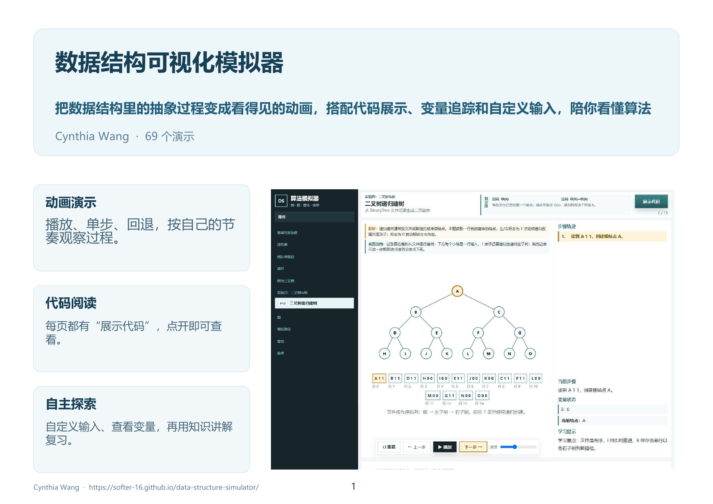
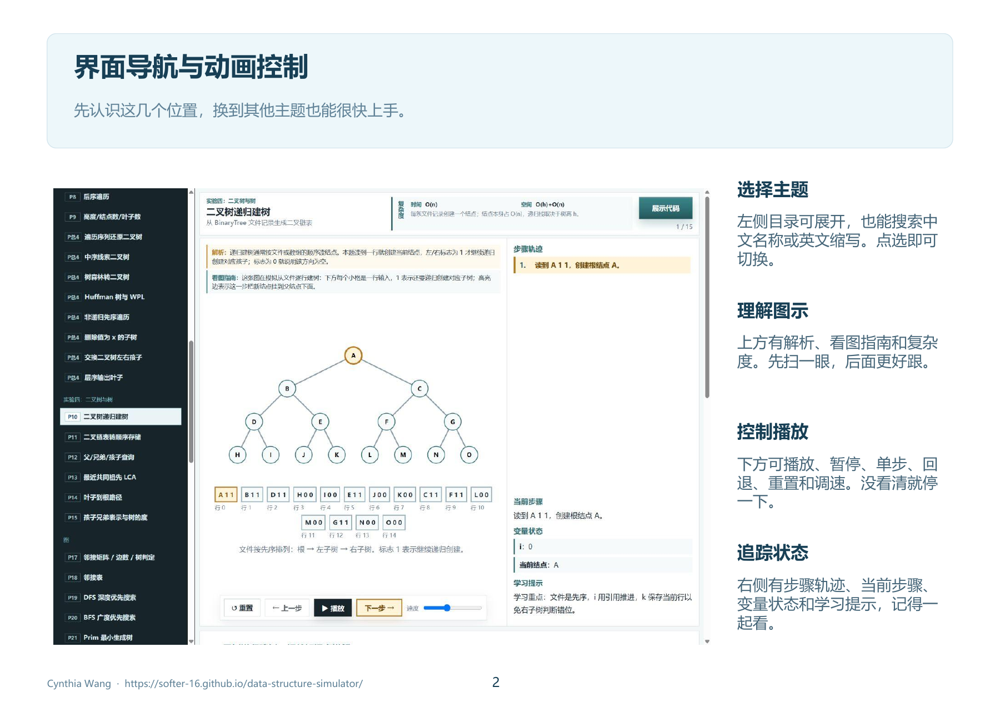
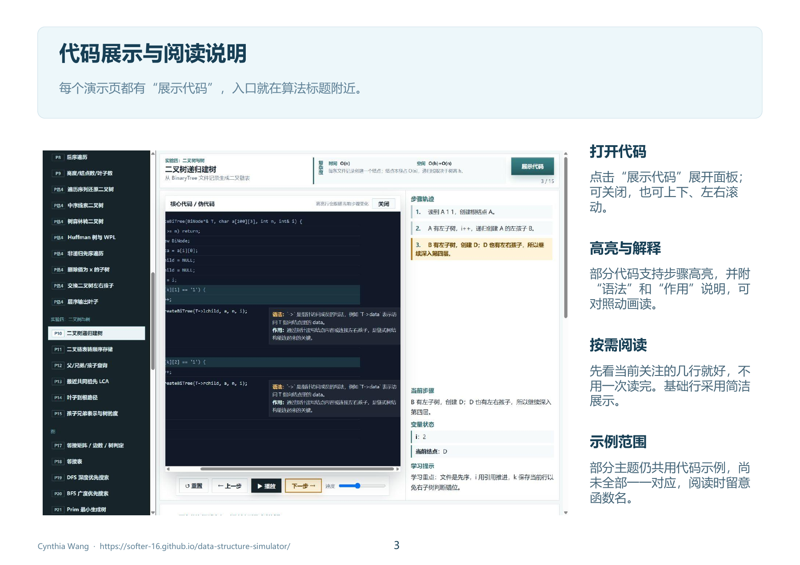
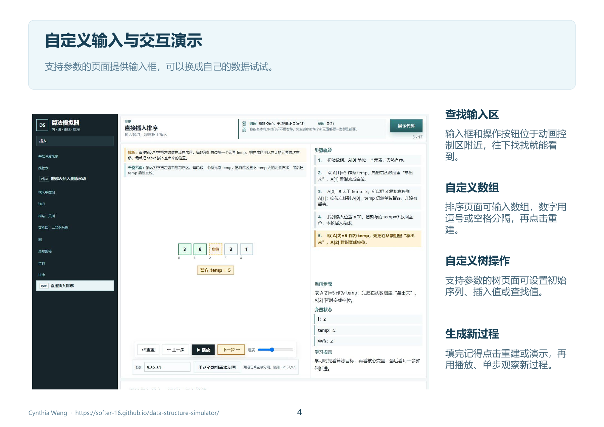
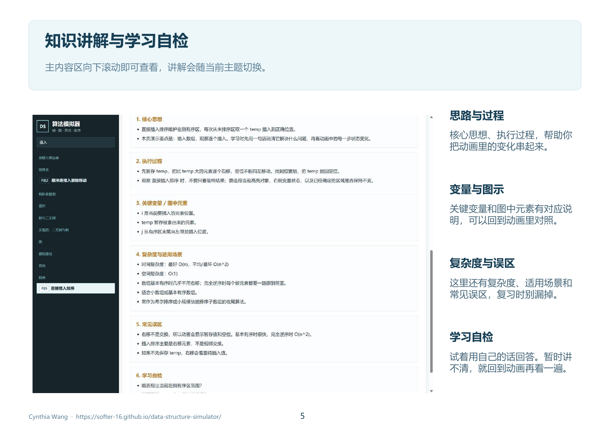

# 数据结构算法可视化交互模拟器

把数据结构里的抽象过程变成看得见的动画，搭配代码展示、变量追踪和自定义输入，帮助理解算法并动手验证想法。

- [在线使用](https://softer-16.github.io/data-structure-simulator/)
- [使用指南 PDF](docs/数据结构可视化模拟器使用指南.pdf)

包含线性表、栈与队列、递归、树、图、查找和排序等 69 个演示。支持播放、单步、回退、代码展示、变量状态和知识讲解；部分页面提供自定义输入。

作者：Cynthia Wang

## 使用指南

